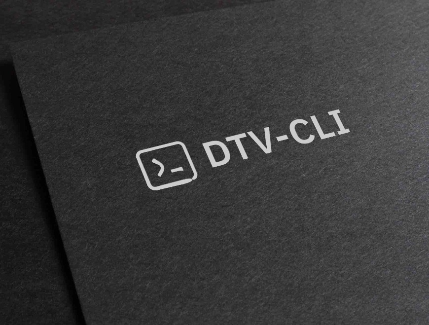

<!-- MANPAGE: BEGIN EXCLUDED SECTION -->
<div align="center">



[](https://github.com/31normaslavik/dtv-cli/releases "Release")
[](https://github.com/yt-dlp/yt-dlp/blob/master/supportedsites.md "Supported Sites")
[](LICENSE "License")
[](https://github.com/31normaslavik/dtv-cli/actions "CI Status")


</div>
<!-- MANPAGE: END EXCLUDED SECTION -->

# INSTALL

### DEPENDENCIES TO RUN
* [vot-cli](https://github.com/FOSWLY/vot-cli)
* [yt-dlp](https://github.com/yt-dlp/yt-dlp)
* [FFmpeg](https://github.com/FFmpeg/FFmpeg)

## SIMPLE INSTALL
```
curl -OL https://github.com/31normaslavik/dtv-cli/releases/latest/download/{dtv-cli,dtv-cli.sha256sum} | sha256sum -c && \
chmod +x dtv-cli && \
sudo mv dtv-cli /usr/local/bin/
```

## INSTALL FROM SOURCE

  ### DEPENDENCIES TO BUILD
* [Boost](https://www.boost.org/) (can be automatically downloaded)
* [fmt](https://fmt.dev) (can be automatically downloaded)

## Binary dependencies to build

### Arch Manjaro
```
sudo pacman -Syu && \
sudo pacman -S git cmake less ffmpeg npm yt-dlp && \
sudo npm install -g vot-cli
```

### Debian
```
sudo apt update && sudo apt upgrade -y && \
sudo apt install git cmake g++ ffmpeg npm yt-dlp -y && \
sudo npm install -g vot-cli
```
### Ubuntu 24.04
```
sudo apt update && sudo apt upgrade -y && \
sudo apt install git cmake g++ ffmpeg npm yt-dlp -y && \
sudo npm install -g vot-cli

```
### Fedora
```
sudo dnf upgrade --refresh && \
sudo dnf install kernel-devel cmake g++ ffmpeg npm yt-dlp && \
sudo npm install -g vot-cli
```
### Pop Os
```
sudo apt update && sudo apt upgrade -y &&
sudo apt install git cmake g++ ffmpeg npm yt-dlp -y && \
sudo npm install -g vot-cli
```
### Mageia
```
sudo urpmi.update -a && \
sudo urpmi cmake gcc git ffmpeg npm yt-dlp && \
sudo npm install -g vot-cli
```
### BookwormPup64
```
sudo apt update && sudo apt upgrade -y && \
sudo apt install git cmake g++ ffmpeg npm yt-dlp -y && \
sudo npm install -g vot-cli
```
### ZorinOs
```
sudo apt update && sudo apt upgrade -y && \
sudo apt install git cmake g++ ffmpeg npm yt-dlp -y && \
sudo npm install -g vot-cli
```
### Solus
```
sudo eopkg update-repo && \
sudo eopkg install linux-current-headers git cmake make gcc g++  system.devel ffmpeg npm yt-dlp && \
sudo npm install -g vot-cli
```

## BUILD WITH CMAKE AND INSTALL
```
git clone https://github.com/31normaslavik/dtv-cli.git && \
cd dtv-cli && \
cmake -S . -B build -D CMAKE_BUILD_TYPE=Release && \
sudo cmake --build build --config Release --target dtv-cli --target install -j4
```

### You can always download the latest binary version of the dtv-cli on the releases page [Release](https://github.com/31normaslavik/dtv-cli/releases)

